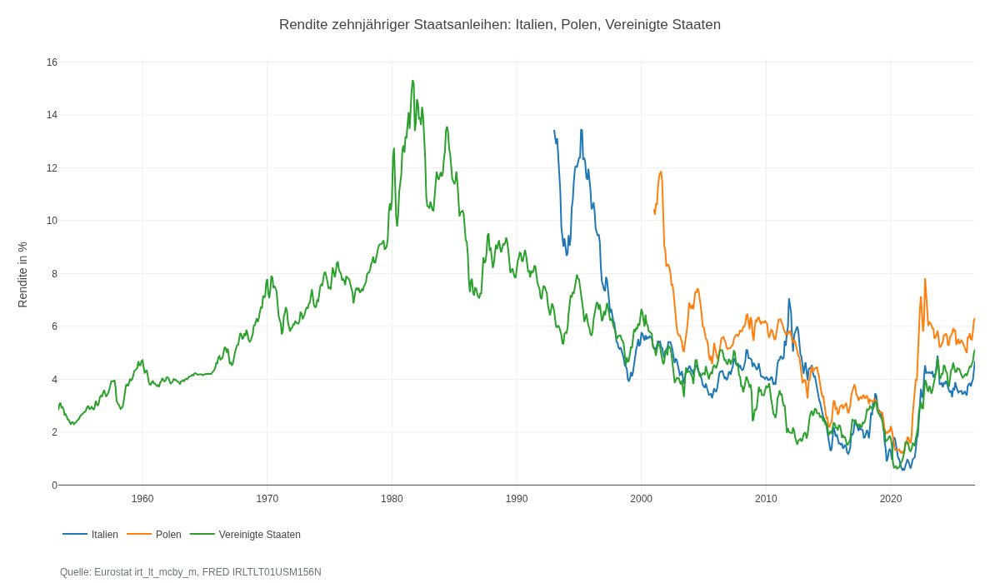
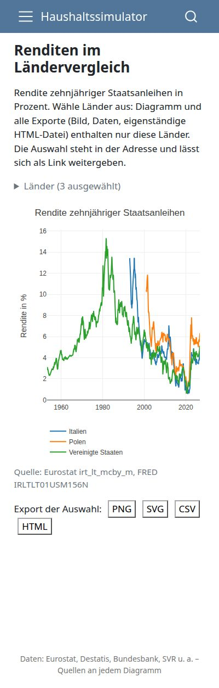

# Evaluation: statische Website (Quarto) neben Streamlit

Stand: 22.11.2026, ergänzt um die Entscheidungen vom selben Tag · Status:
Entscheidungsgrundlage mit Prototyp, kein Umbau · nichts committet, kein Upload

## Kurzfassung

* **Machbar, und der Prototyp läuft.** Eine Quarto-Seite ruft dieselbe Diagrammfunktion
  wie die Streamlit-App auf. Zoom, Hover, Legende und ein Filter im Browser
  funktionieren, und die Seite lädt nichts von fremden Servern. Ein Foliensatz ist als
  PDF, als PNG je Folie und als MP4 exportiert.
* **15 von 17 Seiten** gehen statisch (7) oder mit einem Filter im Browser (8). Der
  Szenario-Rechner wird JavaScript im Browser, der Bericht ein lokales Werkzeug.
  Streamlit wird danach nicht mehr gebraucht; die alte App kommt ins Archiv.
* **Der größte Aufwand ist nicht Quarto**, sondern rund 50 Diagramme aus den
  Seitenskripten in reine Funktionen zu verschieben. Genau das plant auch
  [PLAN_BAUSTEINE.md](../PLAN_BAUSTEINE.md). Beides sollte **ein** Umbau werden, nicht
  zwei.
* **Länderauswahl mit Export geht ohne Server** **[T]**: Man wählt Länder per Häkchen,
  und PNG, SVG, CSV und eine eigenständige HTML-Datei enthalten nur diese Länder, jeweils
  mit den Quellen genau dieser Länder. Die Auswahl steht im Link (Abschnitt 3).
* **Empfehlung:** Quarto für die Seiten. Die Foliensätze bleiben unverändert und werden
  im Workflow mit DeckTape exportiert. Ausgeliefert wird über **Host Europe per SFTP**
  unter **deutschlandmonitor.info**, mit Impressum. Entwickelt wird in einem **neuen
  privaten Repository** (Abschnitt 7). Grob **10–14 Arbeitstage**.
* **Entschieden am 22.11.2026:** SSH-Zugang bei Host Europe ist vorhanden; Domain
  deutschlandmonitor.info (noch zu erwerben); Hosting bei Host Europe; ein Impressum
  wird benötigt; englischer Code, solange die Website auf Deutsch mit Claude erweiterbar
  bleibt; Diagramme mit Länderauswahl sollen sich mit genau dieser Auswahl exportieren
  lassen.

Belegt ist jede Aussage zu Werkzeugen und Hosting entweder durch einen eigenen Test
(**[T]**, Befehle und Messwerte im Text) oder durch eine Quelle (**[Qn]**, Liste am
Ende).

---

## 1. Bestandsaufnahme

Gezählt wurde automatisch mit `grep` in `app/pages/*.py`:
* **Diagramme** sind die Aufrufe von `ui.plot(`; bei „Insolvenzen“ die
  Diagramm-Bausteine.
* **Logik im Skript** ist eine grobe Zählung der Zeilen mit Datenumformungen
  (`.loc`, `.groupby`, `.merge`, Rechenoperatoren, `pd.concat` …), die noch nicht in
  `analysis.py` liegen. Sie zeigt eine Größenordnung, keine genaue Zahl.

| Seite | Diagramme | Steuerelemente | Logik im Skript | Einstufung |
| --- | ---: | --- | ---: | --- |
| Überblick (`0_`) | 3 | – (3 Kennzahlen) | 3 | statisch möglich |
| Zeitreihe (`1_`) | 2 | radio Einheit, slider Zeitraum, multiselect Ebenen | 10 | mit Browser-Filter |
| Ebenen und Schuldenarten (`2_`) | 3 | segmented_control Abgrenzung, pills Ebenen | 3 | mit Browser-Filter |
| Bundesländer (`3_`) | 2 | radio Abgrenzung, multiselect Länder | 4 | mit Browser-Filter |
| Analysen (`4_`) | 3 | – | 8 | statisch möglich |
| Szenario (`5_`) | 1 | 3 × slider (Schulden-, BIP-Wachstum, Horizont) | 6 | **nur Streamlit** (oder Nachbau in JS) |
| Haushalt & Zinsen (`6_`) | 7 | multiselect Aufgabenbereiche, 3 Expander | 24 | statisch, ein Browser-Filter |
| Zinsvergleich (`7_`) | 6 | multiselect Länder, select_slider Zeitraum, selectbox Einkommensgröße | 14 | mit Browser-Filter |
| Quellen (`8_`) | 0 | – (Tabellen) | 0 | statisch möglich |
| Insolvenzen (`9_`, Bausteine) | 3 + Kennzahlen, Tabelle | Ansicht einfach/Experte (global), Parameter | 0 (in `bausteine/`) | statisch möglich (beide Ansichten als Abschnitte) |
| Geld und Kaufkraft (`10_`) | 3 | – | 3 | statisch möglich |
| Energiepreise (`11_`) | 8 | selectbox Kraftstoff, multiselect Länder | 13 | mit Browser-Filter |
| Preisniveau und Wohnen (`12_`) | 3 | multiselect Länder | 6 | mit Browser-Filter |
| Bund und Schuldendienst (`13_`) | 3 | – | 2 | statisch möglich |
| Wirtschaft (`14_`) | 7 | 2 × multiselect Länder, select_slider Zeitraum | 6 | mit Browser-Filter |
| Insights (`15_`) | 0 | radio Foliensatz | 0 | statisch möglich (Linkliste) |
| Bericht (`16_`) | 0 | Korb, Texteingaben, Export | 0 | **nur Streamlit** |

Zusammen sind es **54 Diagramme**:
* **statisch möglich:** 7 Seiten
* **mit Browser-Filter:** 8 Seiten. Fast immer ist es eine Länder- oder
  Zeitraumauswahl. Vieles davon deckt schon die Plotly-Legende ab (Klick blendet eine
  Reihe aus) oder der Zoom.
* **nur Streamlit:** 2 Seiten

Am meisten Logik steckt in „Haushalt & Zinsen“ (Zeitmarken, monatliche Zinslast),
„Zinsvergleich“ und „Energiepreise“.

## 2. Diagramme herauslösen: Beispiel Kernhaushalt (SVR-Abbildung 37)

**Umgesetzt** **[T]**:

* Neues Modul [`src/haushaltssimulator/charts.py`](../src/haushaltssimulator/charts.py)
  mit
  * `core_budget(frame, *, narrow=False) -> go.Figure`,
  * `core_budget_summary(frame) -> str` und den Texten
    `CORE_BUDGET_TITLE/INTRO/CAPTION`.
* Ohne Streamlit. Die Bezeichner sind englisch, die Beschriftungen deutsch (siehe
  CLAUDE.md, „Sprache“).
* Die Fachlogik (Summen, erstes Jahr über 100 %, Zinstief) liegt in
  `analysis.core_budget_highlights()`.
* `app/pages/6_Haushalt_und_Zinsen.py` ruft nur noch
  `ui.plot(charts.core_budget(...), own_legends=True)` auf. Aus rund 180 Zeilen
  Seitencode wurden 15.
* Tests in `tests/test_svr.py`: Parser, Builder, Kennzahlen, Spuren und Achsen des
  Diagramms, Zusammenfassungssatz.
* `uv run pytest` → **251 passed**, `uv run ruff check .` → grün.
* Die App sieht unverändert aus (Playwright-Screenshot,
  [streamlit_kernhaushalt_nach_umbau.jpg](evaluation_statische_website/streamlit_kernhaushalt_nach_umbau.jpg)),
  die Seite zeigt keine Fehlermeldung.

**Befund beim Herauslösen:** Das allgemeine Layout (`ui.style`: Vorlage, Schrift,
Ränder) liegt in `ui.py` und hängt damit an Streamlit. Für die statische Seite musste ich
es in `site/site_layout.py` nachbauen. Vor dem Ausrollen gehört es in ein Modul ohne
Streamlit, das `ui.style` und die Website gemeinsam nutzen.

**Aufwand für alle Seiten (Schätzung):**
* **Beispiel:** Dieses eine Diagramm samt Kennzahlen und Tests hat rund eine Stunde
  gedauert.
* **Leichte Diagramme:** Für die meisten der 54 sind 20–45 Minuten realistisch.
* **Schwere Diagramme:** Das große Zinslast-Diagramm mit fünf Teilbildern, Zeitmarken
  und eigenen Legenden braucht eher einen halben Tag.
* **Summe:** **4–6 Arbeitstage**.
* **Wichtig:** Das ist dieselbe Arbeit wie die „Bausteine“ in PLAN_BAUSTEINE.md. Dort ist
  die Pilotseite „Insolvenzen“ schon umgestellt (`erzeuge(Kontext)` liefert die Figure).
  `charts.py` und `bausteine/` dürfen nicht nebeneinander wachsen. Empfehlung: Bausteine
  (englisch benannt, z. B. `blocks/`) als einzige Abstraktion, `charts.core_budget`
  wird ein Baustein.

## 3. Quarto-Prototyp

Dateien unter [`site/`](../site/):

* `_quarto.yml`: Website mit Navigation, Suche und Fußzeile.
* `haushalt.qmd`, `laender.qmd`, `index.qmd`
* `site_layout.py`: allgemeines Layout, Ausgabe als HTML-Block
* `prepare_site.py`: Pre-Render-Schritt; kopiert plotly.js und die Foliensatz-Dateien
  und schreibt die Daten für die Filter im Browser (`data/*.json`). Das muss vor dem
  Rendern passieren: Dateien, die erst eine Zelle der Seite schreibt, kopiert Quarto
  beim ersten Build nicht nach `_site` **[T]**.
* `styles.css`
* `folien/zinslast-extrakurz.qmd`

Die Build-Ausgabe (`site/_site/`) und kopierte Dateien sind in `.gitignore`
eingetragen. Die bisherige Zeile `/site` (Vorlage für MkDocs) hätte den ganzen Ordner
ignoriert und ist auskommentiert.

### Installation

* **Kein System-Quarto vorhanden, aber das offizielle PyPI-Paket `quarto-cli`
  funktioniert** **[T][Q1]**:

  ```bash
  uv run --with quarto-cli --with nbclient --with nbformat --with ipykernel quarto render site
  ```

  → Quarto **1.11.9**. Die erste Installation dauert **39 s** und lädt 98 Pakete, weil
  die Jupyter-Abhängigkeiten dazukommen.
  * Das Paket lädt die Quarto-Binärdateien bei der Installation von GitHub nach
    **[Q1]**.
  * `pyproject.toml` und `uv.lock` habe ich **nicht** geändert. Für die Umsetzung
    empfiehlt sich eine eigene Abhängigkeitsgruppe `site`.
* In GitHub Actions geht dasselbe über `uv`. Alternativ gibt es die offizielle Action
  `quarto-dev/quarto-actions/setup` **[Q2]**.
* Ein Build der ganzen Website (zwei Seiten und ein Foliensatz) dauert **11–15 s**
  **[T]**.

### Interaktivität

Geprüft mit Playwright in Chrome 156 **[T]**:

| Prüfung | Ergebnis |
| --- | --- |
| Hover | Hoverlabel erscheint (1500 px) |
| Legende | Klick auf „Kreditaufnahme“ → Reihe `legendonly` |
| Zoom | Ziehen im linken Teilbild → x-Achse 2013,6–2022,1 |
| Browser-Filter (Observable JS) | Häkchen „Zinsen“ entfernt → zweites Diagramm hat 3 statt 4 Reihen |

Auf schmalen Bildschirmen (400 px) bestand die Hover-Prüfung nicht. Am Telefon
ersetzt Antippen das Hovern; das habe ich nicht separat getestet.

### Länderauswahl und Export

Frage: Lassen sich Diagramme einzeln exportieren, auch wenn man mehrere Länder auswählt,
und enthält der Export dann nur diese Länder? **Ja, ohne Server.**

Prototyp [`site/laender.qmd`](../site/laender.qmd): Renditen zehnjähriger
Staatsanleihen für 30 Länder (`international_yields`, 184 KB JSON). Häkchen je Land,
dazu vier Export-Knöpfe. Etwa 100 Zeilen eigenes JavaScript, kein Observable, keine
Bibliothek außer plotly.js.

Geprüft mit Playwright in Chrome (Auswahl Italien, Polen, Vereinigte Staaten) **[T]**:

| Prüfung | Ergebnis |
| --- | --- |
| Diagramm | genau die 3 Reihen |
| PNG und SVG (1200 × 700) | nur die 3 Länder; Titel nennt sie; Quellenzeile im Bild |
| CSV (`Monat;Land;Rendite in %`, Dezimalkomma, UTF-8 mit BOM) | nur die 3 Länder; letzte Zeile nennt deren Quellen |
| HTML-Datei | 4,8 MB, plotly.js eingebettet, keine externen Skripte; öffnet offline mit den 3 Reihen |
| Link | Adresse `…/laender.html#laender=Italien,Polen,Vereinigte%20Staaten` stellt die Auswahl in einem neuen Fenster wieder her |
| fremde Server | keine Abrufe |
| Telefon (400 px) | Länderliste eingeklappt, kurzer Titel, Quelle unter dem Diagramm |





Erkenntnisse für die Umsetzung:

* **Reihen weglassen, nicht ausblenden.** Blendet man eine Reihe nur über die Legende
  aus (`legendonly`), steht das Land im exportierten Bild weiter in der Legende
  (ausgegraut) **[T]**. Darum baut die Seite das Diagramm bei jeder Auswahl mit
  `Plotly.react` neu, nur mit den gewählten Ländern.
* **Zwei Layouts:** auf der Seite kurzer Titel und Quelle als Text unter dem
  Diagramm; für den Export feste Größe, Länder im Titel und Quelle im Bild. Der
  Kamera-Knopf von Plotly ist entfernt, weil er das Seitenlayout ohne Quelle
  exportieren würde.
* **Allgemein lösbar:** Die Diagrammfunktion in Python liefert Spuren je Land; ein
  gemeinsames Skript (Auswahl, Link, vier Exporte) lässt sich für alle Seiten mit
  Länderauswahl wiederverwenden. Zeiträume gehen genauso (Plotly-Zoom oder Auswahlfeld).

### Plotly-Einbindung und Datenschutz

Gemessen wurde jede Anfrage an einen fremden Server während des Ladens und Bedienens
**[T]**:

* **plotly.js** wird von der eigenen Website ausgeliefert (`assets/plotly.min.js` aus
  dem installierten plotly-Paket). Es gibt also **keinen** CDN-Abruf; jede Seite bindet
  die Datei einmal ein.
* **Stolperstein 1:** Gibt man die Figure als Jupyter-Anzeigeobjekt aus, fügt Quarto
  jQuery und require.js von `cdn.jsdelivr.net` ein. **Lösung:** Die Figure als rohen
  HTML-Block ausgeben (`#| output: asis`, siehe `site_layout.show`).
* **Stolperstein 2:** `ojs_define()` (Python → Observable JS) bringt dieselben beiden
  CDN-Skripte zurück. **Lösung:** Daten als JSON-Datei schreiben und mit
  `FileAttachment` laden.
* **Stolperstein 3 (offen):** Die Observable-Laufzeit lädt beim ersten Einsatz von
  `Inputs.checkbox` **`@observablehq/inputs` und `htl` von `cdn.jsdelivr.net`** nach.
  Wege für die Umsetzung:
  * Filter mit Plotly-eigenen Mitteln (Legende, `updatemenus`) oder etwas eigenem JS
    bauen, oder
  * die beiden Bibliotheken selbst hosten.
* **Stolperstein 4:** Quarto-Foliensätze laden MathJax vom CDN. **Lösung:**
  `html-math-method: plain`.

**Ergebnis:** Die Kernhaushalt-Seite und der Foliensatz laden nach den Lösungen 1, 2 und
4 nichts mehr von fremden Servern. Nur das Observable-Filterbeispiel lädt noch nach.

### Größe und Ladezeit

Gemessen mit dem lokalen Python-Server **[T]**. Der liefert unkomprimiert aus, das ist
der ungünstigste Fall.

| Seite | Anfragen | roh | gzip | Ladezeit 10 Mbit/s (40 ms Latenz) | Ladezeit 50 Mbit/s |
| --- | ---: | ---: | ---: | ---: | ---: |
| `haushalt.html` | 22 | 6,8 MB | 1,9 MB | 7,3 s bis Diagramme sichtbar | 2,9 s |
| `folien/zinslast-extrakurz.html` | 29 | 0,5 MB | 0,14 MB | 0,6 s | – |
| `index.html` | 20 | 5,8 MB | 1,7 MB | – | – |

* **Größter Posten** ist plotly.min.js mit 4,8 MB roh, 1,5 MB gzip. Er wird pro Besuch
  einmal geladen und dann gecacht.
* **Sparmöglichkeiten:**
  * plotly.js nur auf Seiten mit Diagrammen einbinden; die Startseite lädt es heute
    unnötig mit.
  * Eine kleinere Plotly-Variante wie `plotly-basic` prüfen.
* Ob der Server komprimiert, hängt vom Hosting ab (offene Frage bei Host Europe).
* Die ganze Website ist 13 MB groß, die gemessene Seite 6,8 MB roh.

### Schmale Bildschirme

Screenshots **[T]**:
[1500 px](evaluation_statische_website/quarto_haushalt_1500px.jpg) ·
[400 px](evaluation_statische_website/quarto_haushalt_400px.jpg)

* **Befund:** Das zweispaltige Diagramm fällt bei 400 px zusammen; Achsen und Titel
  überlagern sich. Das gilt auch für die Streamlit-App am Telefon.
* **Lösung im Prototyp:**
  * `charts.core_budget(frame, narrow=True)` setzt die Teilbilder untereinander.
  * Die Website gibt beide Varianten aus und schaltet per CSS bei 700 px um.
  * Das Filterdiagramm nutzt die Seitenbreite (`width` aus Observable).

  Danach ist bei 400 px alles lesbar.
* **Folgerung:** Diagramme mit mehreren Teilbildern brauchen eine schmale Variante. Das
  wäre auch für die App ein Gewinn.

## 4. Foliensätze

### Nachbau in Quarto

`site/folien/zinslast-extrakurz.qmd` baut `insights/zinslast/extrakurz.html` nach:
* `format: revealjs`, 1080 × 1920
* dieselben Stylesheets `stil.css` und `stil-verlauf.css`
* dieselben SVG-Diagramme

Vergleich je Folie bei Skalierung 1 **[T]**:
[Original (oben) und Quarto (unten)](evaluation_statische_website/folien_original_vs_quarto.jpg)

| Kriterium | Original | Quarto-Nachbau |
| --- | --- | --- |
| Kleinste Schrift (berechnet im Browser) | 30 px (Kicker) | 30 px (Kicker) |
| Externe Abrufe | Reveal.js vom CDN (jsDelivr) | **keine** (Reveal.js liegt in `site_libs/`) |
| Aussehen | Referenz | nahezu gleich |
| Aufwand | – | ca. 1,5 h, davon 1 h für Abweichungen |

Abweichungen, die nachgebessert werden mussten:
1. Quarto setzt bei einem einzelnen Bild automatisch `r-stretch`, das Diagramm wächst
   in den Restplatz → Text überlagert die Quelle. Lösung: `auto-stretch: false`.
2. Pandoc packt Text in Kästen in `<p>` mit eigenem Rand → Kästen höher.
3. Der Kicker über der Überschrift muss in die `##`-Zeile, weil `##` eine neue Folie
   beginnt.
4. Pipe-Tabellen kennen keine Zeilenköpfe (`<th>`) → erste Spalte rechtsbündig.

Die Punkte 2–4 behebt die kleine Datei `folien/quarto-anpassung.css`. Das wörtliche
Zitat mit den hervorgehobenen Teilen steht weiter als HTML-Block im Foliensatz.

**Bewertung:** Ein Nachbau lohnt sich nicht. Die Foliensätze sind von Hand gestaltetes
HTML und werden nicht schöner, wenn man sie in Markdown übersetzt. Dazu kämen zwei
Stile, die man gemeinsam pflegen müsste. Zahlen gleicht schon `tests/test_insights.py`
ab.

**Besser:** Die Foliensätze **unverändert als statische Dateien** übernehmen und nur
exportieren. Der einzige Vorteil von Quarto ist, dass Reveal.js nicht mehr vom CDN kommt.
Das lässt sich auch im Original lösen: Reveal.js selbst hosten (npm-Paket oder Kopie
unter `insights/vendor/`).

### Export

Geprüft mit dem Foliensatz `extrakurz` (5 Folien) **[T]**:

| Weg | Werkzeug | Laufzeit | Ergebnis |
| --- | --- | ---: | --- |
| DeckTape 3.17.0 → PDF + PNG je Folie | Node 24 (PyPI-Paket `nodejs-wheel`), vorhandenes Chrome per `--chrome-path` | 21 s | 5 Seiten, 243 KB, Text durchsuchbar; 5 PNGs 1080 × 1920; **originalgetreu** |
| Gleicher Weg mit dem Quarto-Nachbau | wie oben | 21 s | 5 Seiten, 274 KB |
| `?print-pdf` + Chrome headless (`--print-to-pdf`) | nur Chrome | 1 s | **unbrauchbar:** druckt eine leere Seite, bevor Reveal.js geladen ist |
| `?print-pdf` + Playwright (wartet auf `Reveal.isReady()`) → PDF, PNG per `Reveal.slide(i)` | Python, Chrome | 11 s | 5 Seiten, 231 KB; PDF **weicht ab**: Seitenrand fehlt, Titelfolie verrutscht ([Bild](evaluation_statische_website/export_print_pdf.jpg)); die PNGs sind originalgetreu |
| MP4 aus den PNGs | ffmpeg aus dem PyPI-Paket `imageio-ffmpeg` | 11 s | 15 s Video (3 s je Folie), 1080 × 1920, H.264, 0,85 MB |

* **DeckTape** braucht Node ≥ 22.12 und nutzt Puppeteer. Mit `--chrome-path` geht auch
  ein vorhandenes Chrome **[Q3]**.
* DeckTape darf nicht mit `?print-pdf` laufen, weil es jede Folie einzeln aufnimmt
  **[Q3]**.
* Quarto nennt als eingebauten Weg nur Druckansicht und Druckdialog im Browser **[Q4]**.

**In GitHub Actions** sind Google Chrome und Node.js 22 auf `ubuntu-24.04` vorinstalliert
**[Q5]**. Es braucht also nur `npx decktape@3.17.0`. ffmpeg liegt bei Bedarf im
PyPI-Paket `imageio-ffmpeg` bei **[T]**.

## 5. Build und Auslieferung

### Workflow-Entwurf

[`.github/workflows/site.yml`](../.github/workflows/site.yml) (**nicht scharf**):

* Start nur von Hand (`workflow_dispatch`) mit der Auswahl **„nur bauen“** (Vorgabe),
  **„probelauf“** oder **„hochladen“**.
* `uv sync` → Tests → `quarto render site` → DeckTape-Export aller drei
  Zinslast-Foliensätze → Artefakt.
* **Upload in eigenem Job**, nur bei „probelauf“ oder „hochladen“ und nur vom Zweig
  `main`. Beim Probelauf zeigt `lftp mirror --dry-run` nur an, was übertragen und
  gelöscht würde **[Q17]**.
* **Freigabe:** In einem privaten Repository mit GitHub Free gibt es keine Environments,
  also auch keine erforderlichen Prüfer **[Q18]**. Die Freigabe ist deshalb der Start
  von Hand mit „hochladen“; eine zweite Person muss nicht freigeben (Entscheidung
  22.11.2026).
* **Übertragung:** SFTP mit `lftp mirror --reverse --delete` nach `ssh.server-he.de`.
  `lftp` ist auf dem Runner nicht vorinstalliert **[Q5]** und wird per `apt-get`
  nachinstalliert. Der Hostschlüssel kommt aus einem Secret; `sftp:auto-confirm` bleibt
  aus, ein unbekannter Schlüssel bricht also ab **[Q17]**.
* Zugangsdaten nur als Repository-Secrets `HE_SSH_USER`, `HE_SSH_PASSWORD`,
  `HE_SSH_KNOWN_HOSTS`; das Zielverzeichnis als Variable `HE_TARGET_DIR`.
* Den DeckTape-Export und die lftp-Optionen (Handbuch des Ubuntu-Pakets 4.9.2) habe ich
  lokal geprüft, den ganzen Workflow und eine Verbindung zu Host Europe **nicht**.

### Host Europe

Der SSH-Zugang ist im Paket vorhanden (Rückmeldung vom 22.11.2026, KIS-Menüpunkt „SSH
Zugang konfigurieren“). Laut Host Europe gilt für Webhosting-Pakete **[Q7]**:

* Übertragung per **scp, SFTP und rsync** über SSH; Server `ssh.server-he.de`, Port 22
  **[Q6][Q7]**.
* Anmeldung **nur mit Benutzername und Passwort**. „Login mit SSH-Keys“ gibt es erst bei
  den WebServer-Produkten **[Q7]**. Das Passwort liegt deshalb als Secret in GitHub.
* Vom Webspace aus keine Verbindungen zu externen Servern, kein git, keine eigenen
  Dienste **[Q7]**. Der Upload muss also von außen kommen (GitHub Actions), der Server
  kann nichts selbst abholen.
* **Welcher Benutzer:** Für SSH gibt es den Webserver-Benutzer `wp…` und den
  FTP-Benutzer `ftp…`. Dateien des `ftp…`-Benutzers darf der Webserver lesen, aber nicht
  ändern oder löschen; ins Stammverzeichnis darf nur der `ftp…`-Benutzer schreiben
  **[Q25]**. Für eine statische Website reicht Lesen, daher empfehle ich den
  **`ftp…`-Benutzer** für den Upload.
* **SSL:** Im vorhandenen Paket kostet ein Zertifikat von Host Europe extra
  (Rückmeldung 22.11.2026); geplant ist Let's Encrypt wie bisher. Siehe „SSL mit Let's
  Encrypt“ unten.
* **FTPES** bleibt als Ausweichweg: geht mit allen Classic-Paketen **[Q6]**, mit `lftp`
  über `ftp://` und `set ftp:ssl-force true` **[Q17]**.
* Wie belastbar das Shared Hosting bei vielen gleichzeitigen Zugriffen ist, ist nicht
  belegt. Eine statische Website braucht aber keinen Python-Prozess je Besucher.

### Alternative GitHub Pages mit eigener Domain

Entfällt nach der Entscheidung für Host Europe. Zusätzlich gilt: Für private
Repositories gibt es GitHub Pages mit GitHub Free nicht **[Q19]**.

* Läuft im (öffentlichen) Projekt schon für die Foliensätze (`insights-pages.yml`).
* **Eigene Domain:** Subdomain per CNAME, Apex-Domain per A-, ALIAS- oder ANAME-Eintrag;
  der DNS-Eintrag kann bei Host Europe bleiben **[Q10]**.
* **HTTPS** gibt es auch mit eigener Domain, das Zertifikat kommt automatisch von Let's
  Encrypt **[Q11]**.
* **Grenzen** **[Q12]**:
  * Website höchstens 1 GB
  * weiche Grenze von 100 GB Datenvolumen pro Monat
  * Deploy höchstens 10 Minuten
  * kein Betrieb für kommerzielle Zwecke
* **Rechnung für ca. 1000 gleichzeitige Nutzer:**
  * Ein Erstbesuch der Haushaltsseite überträgt 1,9 MB (gzip) bzw. 6,8 MB (roh).
  * 1000 gleichzeitige Erstbesuche sind also 2–7 GB.
  * 100 GB im Monat reichen damit für rund 15.000–50.000 Erstbesuche. Wiederholte
    Besuche laden plotly.js aus dem Browser-Cache.
  * Eine statische Website braucht keinen eigenen Server. Wie belastbar das
    Shared Hosting bei Host Europe bei gleichzeitigen Zugriffen ist, ist nicht belegt.

### Kosten und Datenschutz

| Punkt | GitHub Pages | Host Europe Basic (gewählt) |
| --- | --- | --- |
| Hosting | nur aus öffentlichem Repository kostenlos **[Q19]** | vorhandener Vertrag; Preis nicht ermittelt |
| Domain | – | deutschlandmonitor.info, noch zu erwerben; Preis offen |
| SSL | automatisch, Let's Encrypt **[Q11]** | im Paket kostenpflichtig; Let's Encrypt von Hand einspielen, ab 2027 etwa alle 6 Wochen **[Q27]** |
| Upload | Actions-Artefakt, keine Zugangsdaten nötig | SFTP, Passwort als Repository-Secret **[Q7]** |
| Build | in öffentlichen Repositories kostenlos | privates Repository: Rechenzeit im Wert von 12 USD im Monat inklusive **[Q20]**, bei 0,006 USD je Linux-Minute rechnerisch rund 2000 Minuten; ein Build braucht grob 5–10 Minuten (geschätzt, auf GitHub nicht gemessen) |
| Datenschutz | GitHub ist US-Anbieter; die Datenschutzerklärung nennt Protokolle mit IP-Adressen für die eigenen Dienste und die Website, Pages-Besucher werden nicht eigens erwähnt **[Q13]** | Anbieter und Serverstandort im Vertrag prüfen |
| CDN | keine fremden Abrufe nach den Lösungen 1, 2 und 4 (Abschnitt 3); Original-Foliensätze laden Reveal.js von jsDelivr | gleich |

**Impressum und Datenschutzerklärung:** Entschieden: beide entstehen zusammen, als eigene
Seiten (`impressum.qmd`, `datenschutz.qmd`), in der Fußzeile jeder Seite verlinkt. Die
Angaben (Name, Anschrift, Kontakt) liefert der Betreiber; sie kommen erst mit dem Umbau in
das private Repository. Zur Rechtsgrundlage des Impressums siehe § 5 DDG **[Q14]**. Für
die Datenschutzerklärung ist wichtig, was die Website tatsächlich tut: keine Cookies,
keine fremden Server (Prototyp geprüft **[T]**), Server-Protokolle bei Host Europe
(Umfang beim Anbieter nachfragen). Den Text selbst habe ich nicht entworfen; das ist
keine Rechtsberatung.

### SSL mit Let's Encrypt

* **Laufzeit wird kürzer:** Let's Encrypt stellt heute Zertifikate für 90 Tage aus. Ab
  10.02.2027 sind es standardmäßig 64 Tage, ab 16.02.2028 45 Tage **[Q27][Q28]**.
  Erneuern soll man bei etwa zwei Dritteln der Laufzeit **[Q27]**, also ab Februar 2027
  etwa alle 6 Wochen, ab 2028 etwa jeden Monat.
* **Bei Host Europe nicht automatisierbar (soweit dokumentiert):** Die Webhosting-FAQ
  beschreibt weder das Hochladen eigener Zertifikate noch Let's Encrypt noch eine API
  **[Q26]**. Die SSL-Proxy-Seite sagt nur, bei „einigen Produkten“ sei die „Einbindung
  eigener SSL-Zertifikate möglich“ **[Q29]**. Das Einspielen im KIS bleibt also
  Handarbeit, und zwar bald etwa monatlich.
* **Ausstellen lässt sich automatisieren:** Die HTTP-01-Prüfung legt eine Datei unter
  `http://<domain>/.well-known/acme-challenge/<token>` ab, nur über Port 80 **[Q30]**.
  Das ginge im Workflow per SFTP. Der private Schlüssel darf dabei nicht als Artefakt
  liegen bleiben; sicherer ist, das Zertifikat lokal mit certbot zu erzeugen.
* **Folge:** Mit Let's Encrypt bei Host Europe muss man ab 2027 regelmäßig von Hand ein
  Zertifikat einspielen; vergisst man es, zeigt der Browser eine Warnung. Alternativen
  sind ein Zertifikat von Host Europe (kostet im Paket) oder ein Anbieter, der Let's
  Encrypt selbst einbindet und erneuert (nicht untersucht) → offene Frage.

## 6. Tests für den Seitenbau (Vorschlag)

1. **Schnell, ohne Quarto (immer):** Die Diagrammfunktionen werden direkt getestet, wie
   `tests/test_svr.py` es für `charts.core_budget` zeigt:
   * Spuren
   * Achsentitel mit Einheit
   * Quelle in der Caption
   * Kennzahlen gegen die Daten

   Bei Bausteinen übernimmt das `tests/test_bausteine.py` für alle Bausteine.
2. **`tests/test_site.py`, nur wenn Quarto verfügbar ist** (Markierung `site`,
   z. B. `uv run --group site pytest -m site`), sonst übersprungen wie `test_app.py`
   ohne Daten:
   * `quarto render site` in ein temporäres Verzeichnis, Rückgabewert 0
   * je Seite mindestens ein Plotly-Diagramm im HTML
   * **Datenschutz:** kein `src`/`href` auf fremde Hosts. Das hätte die Stolpersteine
     1, 2 und 4 automatisch gefunden.
   * **Zahlen:** Die Sätze im HTML (z. B. „17,2 %“) stimmen mit `charts.*_summary`
     überein. Das Muster entspricht dem Abgleich mit `kennzahlen.json` in
     `test_insights.py`.
   * **Mindestschrift:** Die Prüfung aus `test_insights.py` (≥ 30 px in CSS/SVG)
     zusätzlich auf `site/folien/` anwenden.
3. **Im Workflow (langsam):** Playwright-Prüfung wie in dieser Evaluation:
   * kleinste berechnete Schrift je Folie
   * fremde Abrufe
   * Screenshots bei 1500 und 400 px als Artefakt

## 7. Übergang in ein privates Repository

Der Umbau soll in einem neuen, nicht öffentlichen Repository passieren. Was das
ändert:

| Thema | Folge im privaten Repository (GitHub Free) |
| --- | --- |
| Fork | geht nicht privat: Forks öffentlicher Repositories sind immer öffentlich **[Q22]** |
| Kopie mit Geschichte | `git clone --bare` + `git push --mirror` in ein leeres neues Repository **[Q21]** |
| Secrets, Variablen, Einstellungen | werden beim Spiegeln nicht erwähnt **[Q21]**; neu anlegen (ohnehin neu für Host Europe) |
| Environments mit Prüfer | nicht verfügbar **[Q18]** → Freigabe per Start von Hand (Workflow-Entwurf) |
| GitHub Pages | nicht verfügbar **[Q19]** → Host Europe |
| Actions | Rechenzeit im Wert von 12 USD im Monat inklusive, Artefakte bis 500 MB; ohne Zahlungsmittel wird danach blockiert, nicht berechnet **[Q20]** |
| Streamlit Community Cloud | App aus privatem Repository ist **privat**, nur für eingeladene Personen sichtbar; nur **eine** private App gleichzeitig **[Q23][Q24]** |

Die Streamlit-App kann also nicht öffentlich aus dem privaten Repository laufen.

**Vorschlag für den Übergang:**

1. **Stand sichern:** die offenen Arbeiten in diesem Repository committen (getrennt:
   Sprachregeln, SVR-Daten, Prototyp, Bausteine).
2. **Neues privates Repository** auf GitHub anlegen, leer (ohne README).
3. **Spiegeln mit vollständiger Geschichte** **[Q21]**:

   ```bash
   git clone --bare https://github.com/<konto>/Haushaltssimulator.git
   cd Haushaltssimulator.git
   git push --mirror https://github.com/<konto>/<neues-repo>.git
   ```

   Danach lokal das neue Repository klonen. Im alten Repository nichts löschen.
4. **Im neuen Repository einrichten:**
   * Secrets `HE_SSH_USER`, `HE_SSH_PASSWORD`, `HE_SSH_KNOWN_HOSTS`
   * Variable `HE_TARGET_DIR`
   * `.env` lokal neu anlegen, nie committen
5. **Das öffentliche Repository einfrieren:**
   * Es bleibt unverändert Quelle der öffentlichen Streamlit-App und der bisherigen
     Foliensätze auf GitHub Pages, bis die statische Website unter
     deutschlandmonitor.info läuft. Keine weitere Pflege.
6. **Abschalten und archivieren** (entschieden 22.11.2026), sobald die statische Website
   alle Seiten abdeckt:
   * Szenario-Rechner als JavaScript im Browser; ein Test vergleicht ihn mit
     `analysis.simulate_debt_ratio`.
   * Bericht als lokales Werkzeug (Skript mit JSON-Konfiguration, `bericht.py`).
   * Lokal anschauen mit `quarto preview site` (baut und lädt bei Änderungen neu
     **[T]**, Quarto-Hilfe 1.11.9).
   * Streamlit-App in der Community Cloud löschen, README-Hinweis auf die neue Adresse,
     Foliensätze auf die neue Domain umziehen, Repository archivieren.

## Vergleich der Werkzeuge

| | Quarto (getestet) | Eigener Generator: Jinja + `fig.to_html` | MkDocs Material |
| --- | --- | --- | --- |
| Aufwand bis zur ersten Seite | gering: Navigation, Suche, Layout für Telefone fertig **[T]** | mittel: Navigation, Layout und Suche selbst bauen; `to_html` funktioniert **[T]** | gering bis mittel |
| Plotly interaktiv | ja **[T]** | ja **[T]** (dieselbe Ausgabe) | über `mkdocs-plotly-plugin` aus Plotly-JSON **[Q15]**, nicht getestet |
| Filter im Browser | Observable JS eingebaut **[T]**, lädt aber Bibliotheken vom CDN nach | eigenes JS | eigenes JS |
| Foliensätze | `format: revealjs` eingebaut **[T]** | im Projekt schon vorhanden (`bericht.py` erzeugt Reveal.js) | nein |
| Export PDF/PNG | separat mit DeckTape **[T]** | separat mit DeckTape | – |
| Abhängigkeiten | Quarto-Binary (40 s Installation, Jupyter-Pakete) **[T]** | nur Python (Jinja) | Python-Pakete |
| Wartung | aktiv (Version 1.11.9 auf PyPI) **[T][Q1]** | alles selbst | **im Wartungsmodus** seit Nov. 2025, Nachfolger Zensical **[Q16]** |
| Fallstricke | CDN-Abrufe (gelöst bis auf OJS), `r-stretch` in Folien | keine fremden, aber alles Eigenbau | Plattformwechsel absehbar |

## Empfehlung und Schrittfolge

**Quarto für die Website**, Foliensätze **unverändert** mit DeckTape-Export, **ein**
gemeinsamer Umbau mit den Bausteinen, in einem **neuen privaten Repository**. Hosting
bei **Host Europe per SFTP** unter **deutschlandmonitor.info**.

| # | Schritt | Aufwand (grob) |
| --- | --- | --- |
| 0 | Privates Repository nach Abschnitt 7 anlegen, Secrets einrichten | 0,5 Tage |
| 1 | Bausteine auf englische Namen umstellen (deutsche Titel und Texte bleiben); `charts.core_budget` als ersten Baustein übernehmen; allgemeines Layout (`ui.style`) in ein Modul ohne Streamlit | 0,5–1 Tag |
| 2 | Diagramme der 15 Seiten außer Szenario und Bericht in Bausteine verschieben, mit schmaler Variante bei Teilbildern | 4–6 Tage |
| 2a | Szenario-Rechner in JavaScript, Bericht als lokales Skript | 0,5–1 Tag |
| 3 | Quarto-Seiten je App-Seite (dünne `.qmd`, die Bausteine ausgibt); Länder- und Zeitraumauswahl mit Export als gemeinsames Skript nach dem Prototyp `laender.qmd` statt Observable `Inputs` | 2–3 Tage |
| 4 | Reveal.js der Foliensätze selbst hosten; DeckTape-Export in den Workflow | 0,5 Tage |
| 5 | Tests nach Abschnitt 6 | 1 Tag |
| 6 | Hosting: Domain deutschlandmonitor.info, Zielverzeichnis, HTTPS (Let's Encrypt); Impressum und Datenschutzerklärung; erster Upload nach Freigabe (Probelauf, dann echt) | 0,5–1 Tag |
| 7 | Streamlit-App abschalten, altes Repository archivieren | 0,5 Tage |
| | **Summe** | **ca. 10–14 Arbeitstage** |

Danach gibt es nur noch eine Oberfläche: die statische Website.

## Entscheidungen vom 22.11.2026

1. **SSH bei Host Europe:** vorhanden → SFTP statt FTPES.
2. **Domain:** deutschlandmonitor.info, noch zu erwerben.
3. **Hosting:** Host Europe.
4. **Impressum und Datenschutzerklärung:** werden benötigt, entstehen zusammen.
5. **Englischer Code:** ja, solange Menschen ohne Englischkenntnisse die Website mit
   Claude auf Deutsch erweitern können (Regeln in `CLAUDE.md`, Abschnitt „Sprache“).
   Spaltennamen bleiben wie in der Quelle oder wie in der App angezeigt.
6. **Export mit Länderauswahl:** gewünscht; geht laut Prototyp (Abschnitt 3).
7. **SSL:** Let's Encrypt statt kostenpflichtigem Zertifikat von Host Europe.
8. **Streamlit:** wird am Ende nicht mehr gebraucht; die alte App kommt ins Archiv.
9. **Freigabe:** Start von Hand genügt, keine zweite Person.
10. **Commit:** erst, wenn alle Fragen geklärt sind.

## Offene Fragen

1. **Domain:** Wird deutschlandmonitor.info bei Host Europe gekauft und dem Paket
   zugeordnet, und in welchem Verzeichnis des Webspace liegt sie (`HE_TARGET_DIR`)?
2. **Let's Encrypt einspielen:** Bisher hat das eine andere Person automatisiert,
   vermutlich mit Hochladen der Prüfdateien per FTP (Rückmeldung 22.11.2026). Das deckt
   das **Ausstellen** ab und geht im Workflow genauso per SFTP. Offen ist das
   **Einbinden** des fertigen Zertifikats ins Paket, für das die FAQ keinen Weg nennt
   **[Q26][Q29]**. Zu klären:
   * Bei der Person nachfragen, wie das Zertifikat ins Paket kam (Werkzeug, KIS-Menü).
   * Im KIS unter „Sicherheit & SSL“ nachsehen, ob ein eigenes Zertifikat hinterlegt ist
     oder hochgeladen werden kann, und mit welchem Ablaufdatum.
   * Bei einer bestehenden Domain mit Let's Encrypt im Browser (Schloss →
     Zertifikat) Aussteller und Ablaufdatum ansehen: Wechselt das Datum etwa alle
     60 Tage von selbst, läuft die Erneuerung bereits automatisch.
   * Ist das Einbinden nur von Hand möglich: Aufwand ab 2027 etwa alle sechs Wochen
     tragbar, oder einen Anbieter mit eingebautem Let's Encrypt prüfen?

   **Befund (22.11.2026):** Ein bestehendes Zertifikat im selben Paket ist ein
   Let's-Encrypt-Zertifikat (Zwischenzertifikat YE2) über **mehrere Domains** (je mit
   und ohne `www`), gültig 90 Tage (05.10.2026–03.01.2027). Mehrere Domains in einem
   Zertifikat deuten darauf hin, dass das Paket nur **ein** Zertifikat aufnimmt; das ist
   eine Vermutung, nicht belegt. Folgen:
   * deutschlandmonitor.info und `www.deutschlandmonitor.info` müssen in **dieses**
     Sammelzertifikat aufgenommen werden, also beim bestehenden Ablauf der anderen
     Person, nicht in einem eigenen Workflow.
   * Ob die Erneuerung automatisch läuft, zeigt sich an der nächsten Ausstellung: bei
     zwei Dritteln der Laufzeit wäre das etwa Anfang Dezember 2026. Ältere
     Ausstellungen listet die Certificate-Transparency-Suche crt.sh.

## Prototyp-Dateien (nicht committet)

* `src/haushaltssimulator/charts.py`
* `analysis.CoreBudgetHighlights`, `analysis.core_budget_highlights`
* Seite `6_Haushalt_und_Zinsen.py` nutzt jetzt `charts`
* `site/`: `_quarto.yml`, `.qmd`-Dateien (darunter `laender.qmd` mit Länderauswahl und
  Export), `site_layout.py`, `prepare_site.py`, CSS
* `.github/workflows/site.yml`
* Screenshots unter `docs/evaluation_statische_website/`
* Eine Zeile in `.gitignore` geändert

Exportierte PDFs, PNGs und das MP4 liegen nur im Scratchpad und sind nicht Teil des
Repos.

## Quellen

* [Q1] PyPI, quarto-cli: <https://pypi.org/project/quarto-cli/>; Repository
  <https://github.com/quarto-dev/quarto-cli-pypi>
* [Q2] quarto-dev/quarto-actions: <https://github.com/quarto-dev/quarto-actions>
* [Q3] DeckTape, README: <https://github.com/astefanutti/decktape>
* [Q4] Quarto, Presenting Slides (Print to PDF):
  <https://quarto.org/docs/presentations/revealjs/presenting.html>
* [Q5] GitHub Actions Runner-Image Ubuntu 24.04 (Chrome, Node.js, Paketliste):
  <https://github.com/actions/runner-images/blob/main/images/ubuntu/Ubuntu2404-Readme.md>
* [Q6] Host Europe FAQ, verschlüsselt übertragen (FTPES, SFTP):
  <https://www.hosteurope.de/faq/webhosting/hochladen-von-webinhalten-ftp/ftp-verschluesselt-uebertragen>
* [Q7] Host Europe FAQ, SSH-Zugang im Webhosting:
  <https://www.hosteurope.de/faq/webhosting/webpack/ssh-zugang-webhosting/>
* [Q8] Hostometer, Host Europe Basic: <https://hostometer.net/en/webhosting/34-HostEurope-Basic>
  (Drittanbieter)
* [Q9] SamKirkland/FTP-Deploy-Action: <https://github.com/marketplace/actions/ftp-deploy>
* [Q10] GitHub Docs, About custom domains and GitHub Pages:
  <https://docs.github.com/en/pages/configuring-a-custom-domain-for-your-github-pages-site/about-custom-domains-and-github-pages>
* [Q11] GitHub Docs, Securing your GitHub Pages site with HTTPS:
  <https://docs.github.com/en/pages/getting-started-with-github-pages/securing-your-github-pages-site-with-https>
* [Q12] GitHub Docs, GitHub Pages limits:
  <https://docs.github.com/en/pages/getting-started-with-github-pages/github-pages-limits>
* [Q13] GitHub General Privacy Statement:
  <https://docs.github.com/en/site-policy/privacy-policies/github-general-privacy-statement>
* [Q14] § 5 DDG: <https://www.gesetze-im-internet.de/ddg/__5.html>
* [Q15] mkdocs-plotly-plugin: <https://pypi.org/project/mkdocs-plotly-plugin/>
* [Q17] lftp-Handbuch aus dem Ubuntu-Paket `lftp` 4.9.2-2ubuntu1.1
  (`/usr/share/man/man1/lftp.1.gz`: `mirror --reverse`, `--delete`, `--dry-run`,
  `--env-password`, `sftp:auto-confirm`, `ftp:ssl-force`); Projektseite
  <https://lftp.yar.ru>
* [Q18] GitHub Docs, Managing environments for deployment (Verfügbarkeit nach Tarif):
  <https://docs.github.com/en/actions/managing-workflow-runs-and-deployments/managing-deployments/managing-environments-for-deployment>
* [Q19] GitHub Docs, GitHub's plans: <https://docs.github.com/en/get-started/learning-about-github/githubs-plans>
* [Q20] GitHub Docs, About billing for GitHub Actions:
  <https://docs.github.com/en/billing/managing-billing-for-your-products/managing-billing-for-github-actions/about-billing-for-github-actions>
* [Q21] GitHub Docs, Duplicating a repository:
  <https://docs.github.com/en/repositories/creating-and-managing-repositories/duplicating-a-repository>
* [Q22] GitHub Docs, About permissions and visibility of forks:
  <https://docs.github.com/en/pull-requests/collaborating-with-pull-requests/working-with-forks/about-permissions-and-visibility-of-forks>
* [Q23] Streamlit Docs, Share your app (private Apps, eine private App):
  <https://docs.streamlit.io/deploy/streamlit-community-cloud/share-your-app>
* [Q24] Streamlit Docs, Connect your GitHub account:
  <https://docs.streamlit.io/deploy/streamlit-community-cloud/get-started/connect-your-github-account>
* [Q25] Host Europe FAQ, Dateirechte-Struktur (wp- und ftp-Benutzer):
  <https://www.hosteurope.de/faq/webhosting/webpack/dateirechtestruktur/>
* [Q26] Host Europe FAQ, SSL im Webhosting:
  <https://www.hosteurope.de/faq/webhosting/sicherheit-ssl/ssl-webhosting-haeufige-fragen>
* [Q27] Let's Encrypt, 64-Day Certificate Lifetimes Coming Feb 2027 (07.10.2026):
  <https://letsencrypt.org/2026/10/07/64-day-certs>
* [Q28] Let's Encrypt, From 90 to 45 (02.12.2025):
  <https://letsencrypt.org/2025/12/02/from-90-to-45>
* [Q29] Host Europe FAQ, SSL-Proxy:
  <https://www.hosteurope.de/faq/webhosting/sicherheit-ssl/ssl-proxy>
* [Q30] Let's Encrypt, Challenge Types: <https://letsencrypt.org/docs/challenge-types/>
* [Q16] Material for MkDocs, Ankündigung Zensical (5.11.2025):
  <https://squidfunk.github.io/mkdocs-material/blog/2025/11/05/zensical/>; Wartungsmodus:
  <https://github.com/squidfunk/mkdocs-material/issues/8523>
